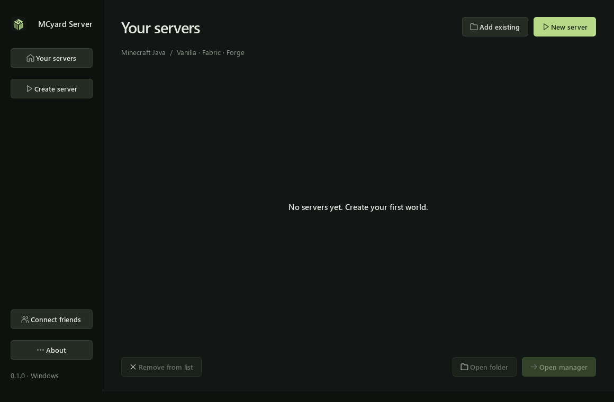

# MCyard Server

A Minecraft server workshop for your Windows PC. Create a server, keep its files
organized, and manage your friends' world without living in a terminal.

**Version 0.1.1:** Windows x64 · Vanilla, Fabric and Forge · Separate server folders



## Start playing

1. Download the **setup EXE** from [GitHub Releases](https://github.com/noxian0/mcyardserver/releases/latest).
   Run it, then open the new **MCyard Server** Desktop
   shortcut. Setup installs the app for your Windows account and checks Java 25;
   if it is missing, it downloads a verified Eclipse Temurin runtime. Python and
   Qt are included. Java 17 and 21 are optional setup choices for older servers.
2. Choose **Create server**, then select Vanilla, Fabric or Forge and a Minecraft
   version. The wizard lists compatible loader versions from the publisher.
3. Give it a name, choose its folder, RAM and port, and select a compatible
   Java runtime. The wizard shows the required version and an **Install Java**
   button if none is found. Read the linked Minecraft EULA and accept it if you
   agree; the checkbox starts unchecked.
4. Wait for setup, open the new server from the library, and press **Start**.
   The first start finishes any launcher downloads and generates the world.
5. Join from Minecraft Java using `localhost` on the host PC. See
   [connecting friends](docs/CONNECTING.md) for LAN and internet access.

The app runs the server **on your PC**. The PC must stay on and awake for friends
to play. MCyard Server does not provide cloud hosting or a public tunnel.

Prefer a portable copy? Extract the complete Windows ZIP and keep its executable
and supporting folders together. See [Windows setup](docs/INSTALLER.md) for
installation, updates, Java requirements and uninstalling.

## What's included

- A server library and guided setup with version selection, downloads and new folders.
- Start, stop, restart and a command console for Vanilla, Fabric and Forge.
- Editable RAM allocation and searchable `server.properties` settings.
- A mod list: disable a JAR without deleting it, then enable it again when needed.
- Moving banners with actual world day/night lighting and a saved Animations switch.
- Player item transfers with optional chat announcements, Kill and Freeze/Unfreeze controls in the management preset.
- Verified full snapshots before starts and after clean stops, sharing a
  **50 GB cap per server** including temporary backup files.

| Setup | Features |
| --- | --- |
| Vanilla | Official Minecraft server, console, settings, RAM and offline backups. No mod loading. |
| Fabric | Compatible loader choices and mod toggles, plus the common controls above. |
| Forge | Compatible installer choices, installation of libraries and mod toggles, plus common controls. |
| Fabric 26.3 management preset | Adds live inventory/Ender Chest inspection, player IPs and history, spawn/death locations, world-rule controls, metrics and live backups. |

The management preset installs Fabric API, Forge Config API Port, Simple Backups,
the original MCyard Server Bridge, and optional Lithium. Other versions are created
without those version-specific mods. Core management mods are protected from being
disabled because the live controls and backup limit depend on them.

Minecraft versions start at 1.18; snapshots and older releases are outside this
release's scope. Available choices come from the publishers' current catalogs.
Mods must match both the selected Minecraft version and loader. The app does not
resolve third-party mod dependencies or automatically upgrade existing worlds.

## Where your files go

By default, servers live in `%LOCALAPPDATA%\MCyard Server\servers`. You can choose a
different parent folder in the wizard. The app folder and server folders stay
separate, so updating MCyard Server does not mean replacing a world.

Use **Add existing** to import an existing Vanilla, Fabric or Forge server folder.
The preview shows its detected version, Java and RAM. Import adds app metadata
and keeps the world, mods and server settings in their original folder. It needs
one recognizable launcher, an already accepted `eula.txt`, and `level-name=world`.
Custom launcher scripts and automatic modpack installation are not supported.
**Remove from list** removes a library entry; it does not delete server files.

[Setup and files](docs/GETTING_STARTED.md) · [Backups and restore](docs/BACKUPS.md)
· [Troubleshooting](docs/TROUBLESHOOTING.md)

## Build or run from source

Use Windows x64 and Python 3.14 for the tested build environment:

```powershell
py -3.14 -m venv .venv
.\.venv\Scripts\Activate.ps1
python -m pip install -e ".[build]"
python -m mcyard
```

Build the portable Windows folder and installer:

```powershell
python scripts/build_windows.py
python scripts/build_installer.py
```

The app is written to `dist/MCyard Server/MCyard Server.exe`. The installer build
requires Inno Setup 6 and creates **MCyard Server Setup.exe** in the project root,
with versioned installers and ZIPs in `release`. The included GitHub workflow
builds downloadable artifacts; it does not automatically publish a release.

[Build notes](docs/DEVELOPMENT.md)
· [Security and privacy](SECURITY.md) · [Changelog](CHANGELOG.md)

## Current limits

- Windows x64 and Minecraft Java are supported. Bedrock, Paper, NeoForge and
  automatic modpack imports are not included. Advanced live telemetry is currently
  available only with the Fabric 26.3 management preset.
- Java and an internet connection are needed for server setup. Downloads may fail
  when upstream services are unavailable; a failed setup does not replace an
  existing server folder.
- Files manually copied into `backups` are not controlled by an operating-system
  quota. The 50 GB guard governs MCyard Server/Simple Backups creation and retention.
- Backups on the same disk do not protect against losing that disk.
- The Windows executable is unsigned; a new download may display a Windows
  reputation warning.

## License and artwork

MCyard Server is free for personal, non-commercial use under the
[MCyard Server Custom License](LICENSE). Redistribution, modification and paid
bundling require the author's permission, subject to the exceptions in that
license. Source is provided for inspection and permitted personal builds.
Third-party libraries retain their own licenses; see
[third-party notices](THIRD_PARTY_NOTICES.md). Minecraft, Java and downloaded mod
licenses are separate. No Minecraft artwork, worlds or player data are included.

**NOT AN OFFICIAL MINECRAFT PRODUCT. NOT APPROVED BY OR ASSOCIATED WITH MOJANG OR
MICROSOFT.** Minecraft is a trademark of Mojang Synergies AB.
