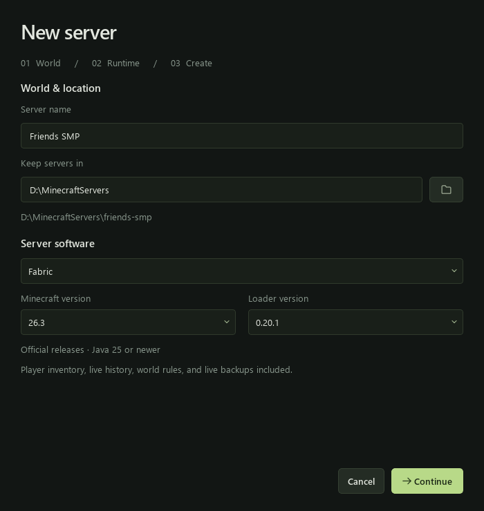

# Your first server

Run **MCyard Server Setup.exe** to install the app and create its Desktop shortcut.
Setup checks Java 25 by default and downloads it only if needed. Java 17 and 21
are optional choices for older Minecraft versions. The app includes Python and
Qt, so you do not install those separately. See [Windows setup](INSTALLER.md).

Open MCyard Server and choose **Create server**. The setup wizard offers:



| Option | What it means |
| --- | --- |
| Server type | Vanilla, Fabric or Forge. Select the Minecraft version and compatible loader. |
| Name | The label in your library and the initial server-list message. |
| Parent folder | Where the new server folder will be created. Existing folders are never overwritten. |
| RAM | The Java memory limit. Start with 4 GB and leave memory available for Windows and your Minecraft client. |
| Port | Usually `25565`. Each simultaneously running server needs a different port. |
| Java | A compatible `java.exe`; use **Install Java** if none is found. Forge uses the matching major. |
| Lithium | An optional server performance mod in the tested preset. |
| Minecraft EULA | Read the linked agreement and explicitly accept it before setup. |

Creating a server downloads the chosen server or loader, runs the Forge installer
when selected, writes the settings and adds the completed folder to your library.
Only the Fabric 26.3 management preset installs its version-specific helper mods. It does not start the
server. You can cancel during setup; only the new temporary setup folder is
removed. If setup completes but the library update fails, use **Add existing
folder** to select the completed folder.

Open the server and press **Start**. On its first run, the launcher finishes any
required library downloads, then Minecraft creates the world. Later starts make
a full snapshot first. Use **Stop** to save and close cleanly; the app makes
another snapshot after a clean shutdown.

## Folder layout

```text
chosen-parent/
  my-server/
    mcyard.json             # App metadata, RAM, Java path and installed versions
    server.properties          # Minecraft settings
    eula.txt                   # Your explicit setup acceptance
    server.jar / fabric-....jar # Vanilla or Fabric launcher
    libraries/                 # Forge launch arguments and dependencies
    mods/                      # Active .jar files and inactive .jar.disabled files
    config/                    # Mod configuration
    world/                     # Created at first start
    manager/data/              # Local bridge state and player/admin history
    logs/
    backups/
      full-server/
      world/
```

The app's library is stored in `%LOCALAPPDATA%\MCyard Server\servers.json`.
Forgetting a library entry leaves the entire server folder intact. To move a
server, stop it, close its manager, move the folder, then add its new location to
the library.

## Import an existing server

Choose **Add existing** in the library and select the server folder. MCyard Server
recognizes Fabric launcher filenames, installed Forge launch arguments, and
official Vanilla server JARs. Review the detected version, name, Java path and RAM,
then click **Import server**. No downloads or world conversions run during import.

Import keeps the original world, mods, settings, and player history in place. It
adds `mcyard.json` and a library entry. An existing accepted `eula.txt` is required;
the app does not accept it for you. The world folder must be named `world`. If
several launchers are found, choose a folder with one active server installation.

Compatible legacy management bridges are reused and protected in the Mods page.
Do not install a second management bridge alongside an existing one. Initial RAM
and timezone settings are retained when detected in `start-server.bat`.

## RAM and mods

Stop the server, open **Settings**, change its memory allocation and save. The next
start uses the saved limit. This is a maximum heap, not a promise that the server
will use all that memory. Leave room for Windows and your Minecraft client.

Open **Mods** to see the JAR files in that server's `mods` folder. Use **Open mods
folder** to copy in compatible server mods, then refresh the list. Stop the server
before changing a mod. Disabling renames `example.jar` to `example.jar.disabled`;
enabling restores the original name. The file is not deleted. A name collision
is refused. Vanilla does not load mods.

The app does not automatically resolve dependencies. Disabling a required mod can
prevent another mod from loading. The management preset's bridge and backup
dependencies stay enabled; optional Lithium can be switched off.

## Daily controls

- **Players:** select a player for profile, inventory and history. The three-dot
  menu includes Kill, Freeze/Unfreeze, removing OP and setting a spawn point.
- **World rules:** the management preset exposes live switches. Other setups
  accept the matching Minecraft `gamerule` commands through Console.
- **Settings:** common options appear first; use the category menu or search for
  advanced properties. Stop the server before saving these changes.
- **Console:** enter a server command without a leading slash.
- **Backups:** inspect storage usage, create a backup or open the archive folder.

Ctrl+1 through Ctrl+8 switch pages. Ctrl+L opens and focuses the console.
Turn **Animations** off in the library sidebar or the server's **Settings** page.
The choice is saved for your Windows account and applies to other open MCyard
windows. `MCYARD_REDUCED_MOTION=1` also forces animations off.

The panorama pans smoothly and follows the Overworld's actual day/night clock.
The management bridge supplies live time and weather. Servers started by the app
without the bridge use a lightweight time query. A stopped server uses its last
saved time; the app never advances Minecraft time on its own. Turning animations
off freezes movement and transitions while keeping the correct lighting.
Rendering is capped at 30 fps and stops when the banner is hidden or the window
is minimized. Images are cached instead of resized every frame.

Inventory and detailed event history require the Fabric 26.3 management preset.
Other setups retain basic controls and the command console.

In a player's **Inventory** tab, click an item and choose an online recipient,
amount, and **Transfer**. Equipment and Ender Chest items can also be moved to
the recipient's main inventory. **Announce in chat** adds an optional plain-text
message after a successful transfer. Both players must be online; a full target
inventory or a changed source stack cancels the transfer without moving items.
These transfers and movement freezing require the updated management bridge.
Frozen players can still look around; unfreeze them from the same menu. Freezes
clear on disconnect, death/respawn, or server restart.

## Backgrounds

Every server gets a banner, including newly created servers. The app can reuse
a verified panorama from your installed Minecraft asset cache, shared locally at
`%LOCALAPPDATA%\MCyard Server\background.png`. Existing per-server backgrounds
still take precedence. If Minecraft's assets are unavailable, an original MCyard
forest illustration is included as the fallback.

You may set `MCYARD_BACKGROUND_IMAGE` to a personal image, or replace the shared
`background.png`. `MCYARD_MINECRAFT_HOME` can point to a nonstandard Minecraft
installation. Images stay on your PC; no game artwork is downloaded or bundled
in releases. Do not add imported Minecraft artwork to a public source archive.
